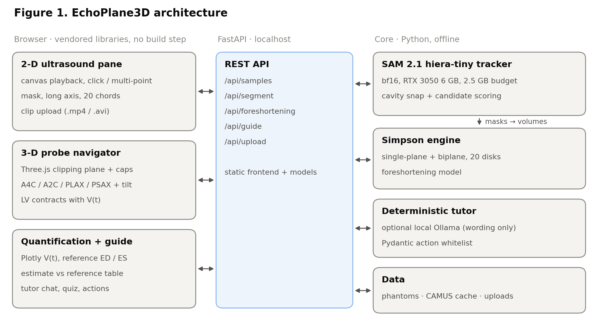
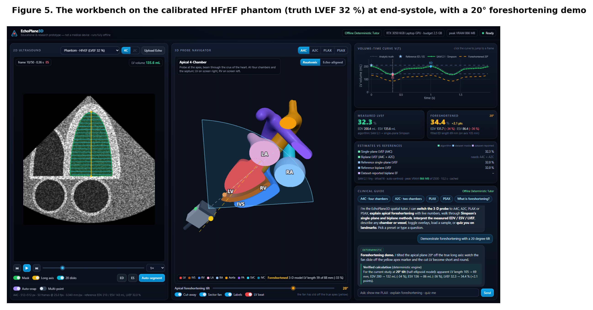

# EchoPlane3D

**An offline split-screen workbench that couples a video foundation model (SAM 2.1) with 3-D cardiac plane slicing
for echocardiography training.**

> **Educational and research simulation prototype — not a medical device.** It is not FDA- or CE-cleared, it has
> not been validated for patient care, and nothing it shows is a diagnosis or a clinical measurement.



| Pane | What it does |
|---|---|
| **2-D ultrasound** | Plays an apical clip; click the LV cavity (or press *Auto-segment*) and SAM 2.1 tracks it through the cycle. Shows the mask, the long axis and the 20 Simpson disks. Click-snapping, multi-point prompts (Shift+click = "not cavity"), clip upload. |
| **3-D probe navigator** | A nine-structure heart (LV, IVS, RV, LA, RA, aorta, pulmonary artery, venae cavae) cut by the A4C, A2C, PLAX or PSAX plane with a live sector fan. A **tilt slider (0–30°)** slides the apical plane off the true apex to show foreshortening. The LV contracts with the measured V(t). |
| **Quantification + guide** | V(t) curve with reference ED/ES markers; single-plane and biplane EDV/ESV/LVEF next to the dataset's reference values; the foreshortened LVEF the tilted plane would report; an offline tutor that switches views, explains, and quizzes landmarks. |

Everything runs on one machine with **no network connection**: the JavaScript libraries are vendored, the tutor
is deterministic (an optional *local* Ollama model may rephrase explanations), and no cloud service is used.

---

## Installation

Tested on WSL2 Ubuntu 22.04, Python 3.10.12, NVIDIA RTX 3050 Laptop 6 GB (CUDA 12.4), Chrome on Windows 11.

```bash
python3.10 -m venv ~/echo_env && source ~/echo_env/bin/activate
pip install torch==2.6.0 torchvision==0.21.0 --index-url https://download.pytorch.org/whl/cu124
pip install -r requirements.txt
sudo apt-get install -y ffmpeg

# SAM 2.1 at the commit used for every reported result, plus the tiny checkpoint
git clone https://github.com/facebookresearch/sam2.git ~/sam2
git -C ~/sam2 checkout 2b90b9f5ceec907a1c18123530e92e794ad901a4
pip install -e ~/sam2
(cd ~/sam2/checkpoints && wget https://dl.fbaipublicfiles.com/segment_anything_2/092824/sam2.1_hiera_tiny.pt)
```

If SAM 2 lives elsewhere, set `ECHOPLANE_SAM2_REPO` (and optionally `ECHOPLANE_SAM2_CHECKPOINT`).
A GPU is needed for tracking; without CUDA the workbench still serves the 3-D navigator, the maths and the tutor,
and the test suite skips GPU tests.

## Quick start

```bash
./run_echoplane.sh            # generates phantoms (+ CAMUS demo cohort if reachable) on first run
```

Open <http://localhost:8000>. Other modes: `./run_echoplane.sh --check` (environment), `--test` (pytest),
`--rebuild` (regenerate the heart model and samples).

**Sample library** (`scripts/prepare_samples.py`): two calibrated phantoms with analytic truth (LVEF 60 % and
32 %), and — downloaded from the CAMUS host on first run, not redistributed — eight real patients with both
apical views, chosen across ejection-fraction bands and image quality. See
[`documentation/DATASETS.md`](documentation/DATASETS.md).

**Optional local LLM.** Install [Ollama](https://ollama.com), `ollama pull qwen2.5:1.5b`, and keep it running;
the header badge switches to *Ollama Local LLM*. Configure with `ECHOPLANE_OLLAMA_URL`,
`ECHOPLANE_OLLAMA_MODEL`, or turn it off with `ECHOPLANE_OLLAMA=off`. Calculations, quizzes and UI commands always
come from the deterministic engine.

## How it measures

* **Single plane:** `V = π/4 · Σ Dᵢ² · L/20` along the mask's principal axis.
* **Biplane** (Lang et al., ASE/EACVI 2015): `V = π/4 · Σ aᵢ bᵢ · max(L_A4C, L_A2C)/20`, available once both
  apical clips of a subject have been segmented; a long-axis mismatch above 10 % is flagged.
* **Foreshortening model:** a half prolate ellipsoid cut by a plane through the mitral-annulus centre, tilted by
  θ, has apparent length `a′ = 1/√(cos²θ/a² + sin²θ/b²)`.

Details: [`documentation/ARCHITECTURE.md`](documentation/ARCHITECTURE.md).

## Validation

<!-- numbers-from-results -->
From one run of `scripts/run_paper_benchmarks.py` (2026-11-18, NVIDIA GeForce RTX 3050 6GB Laptop GPU); full tables in `results/`,
method and caveats in `paper/softwarex_manuscript.md`. **Reference** = CAMUS expert masks measured with the same
Simpson code (not clinical ground truth).

| Check | Result |
|---|---|
| 20-disk Simpson on a 104.72 mL prolate ellipsoid (25 spacing × rotation cases) | worst error 0.40 % |
| Calibrated phantoms, full tracking (truth LVEF 60.0 % / 32.0 %) | LVEF 60.6 % / 32.3 %, mean Dice 0.984 / 0.986 |
| 30 held-out CAMUS patients, single frames: median Dice, stock SAM vs EchoPlane3D snapped click / multi-point / automatic | 0.275 vs 0.667 / 0.744 / 0.646 |
| Same patients, full-cycle tracking, biplane LVEF vs reference (snapped click) | MAE 9.7 points, bias +4.7, 95 % LoA −21.5 to +30.9, ICC 0.58 |
| Same, automatic prompt (no reference input) | MAE 12.9 points, ICC 0.48 |
| Peak GPU memory over 154 tracking runs (budget 2,500 MB) | ≤ 866 MB, median 168 ms per frame |
| Test suite on the GPU machine | 182 passed of 182 |

The limits of agreement are far wider than clinical tolerance: use EchoPlane3D to learn *why* measurements vary,
never to measure a patient.
<!-- /numbers-from-results -->



To reproduce: `python scripts/run_paper_benchmarks.py` (≈ 69 min including downloads), then
`python scripts/build_paper_numbers.py` to regenerate the numbers in this README and in `paper/`.


## Repository layout

```
backend/            FastAPI app (main.py) and core modules (tracker, maths, tutor, CAMUS, uploads)
frontend/           index.html + app.js (no build step), vendor/ libraries, models/ heart GLB + plane poses
scripts/            prepare_samples.py, build_heart_glb.py, run_paper_benchmarks.py, benchmark_tracker.py
tests/              pytest suite (GPU and CAMUS tests skip when unavailable)
results/            benchmark tables, figures, provenance manifest
documentation/      architecture, datasets, publication guide
paper/              JOSS and SoftwareX manuscript drafts
```

## Citing

See [`CITATION.cff`](CITATION.cff). Please also cite SAM 2 (Ravi et al., 2024) and, if you use it, the CAMUS
dataset (Leclerc et al., IEEE TMI 2019, doi:10.1109/TMI.2019.2900516).

## Licence and acknowledgements

MIT ([`LICENSE`](LICENSE)). Third-party components and their licences: [`THIRD_PARTY_NOTICES.md`](THIRD_PARTY_NOTICES.md).

**AI-assisted development.** Most of the code, tests and documentation were written with an AI coding assistant
(Anthropic Claude, via Claude Code) working from the specifications in `CLAUDE.md` and `UPGRADE_SPEC.md`;
the human author set the requirements, reviewed the outputs and is responsible for the work. Every reported number
is produced by the scripts in this repository.
