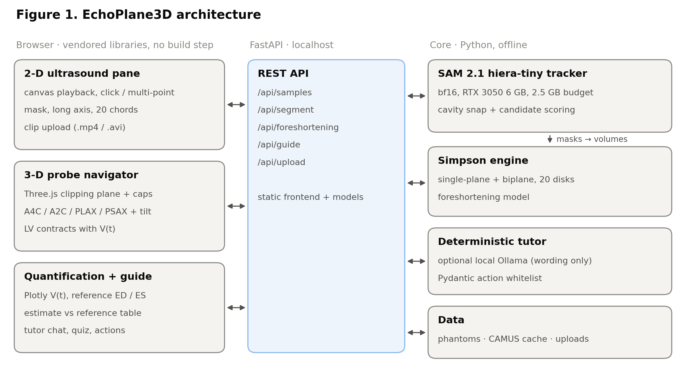
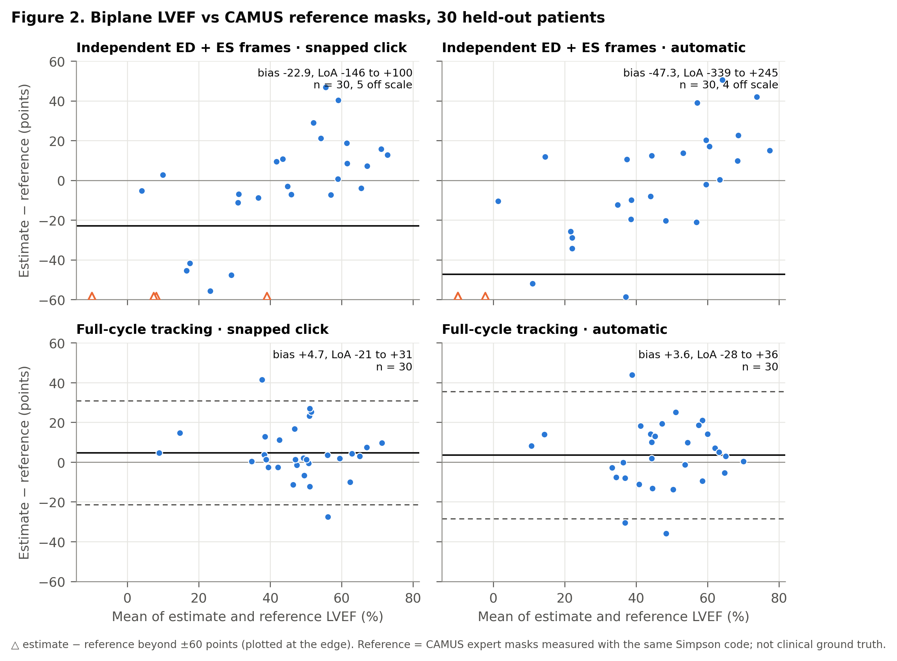
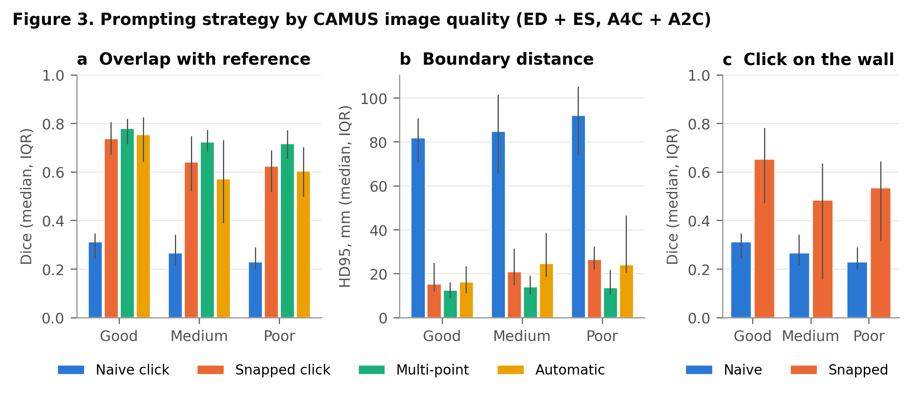
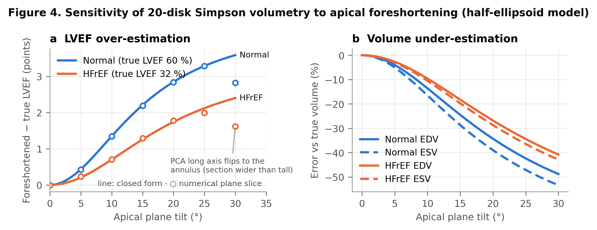
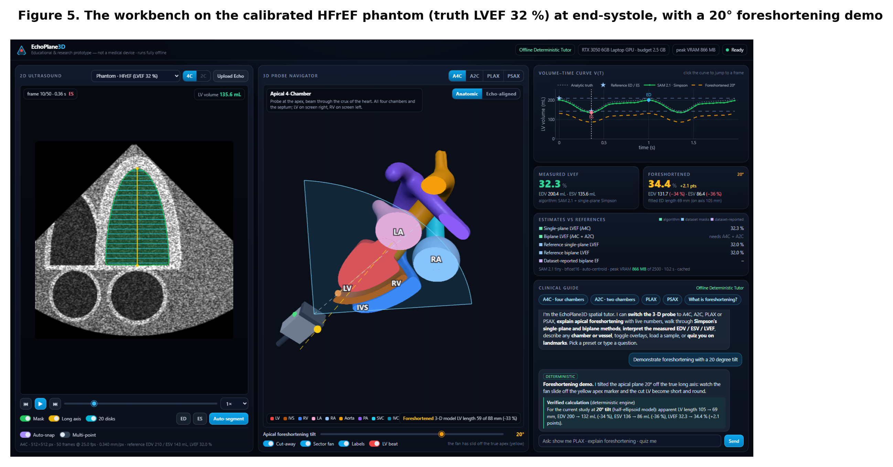

# EchoPlane3D: an open-source, offline split-screen workbench coupling video foundation models with 3D cardiac plane slicing for echocardiography training

**Authors:** Burhan Zaim — **Affiliations:** Faculty of Medicine and Health, Al-Farabi Kazakh National University, Almaty, Kazakhstan — **Corresponding author:** Burhan Zaim (YOUR_EMAIL@example.com)

> Draft for the Elsevier SoftwareX *Original Software Publication* template. Move the text into the official
> Word/LaTeX template before submission (see `documentation/PUBLICATION_GUIDE.md`). Every number in this file
> is generated from `results/` by `scripts/build_paper_numbers.py`; do not edit numbers by hand.

## Abstract

<!-- numbers-from-results -->
Measuring left-ventricular ejection fraction (LVEF) with the method of disks depends on the 3-D relation
between the imaging plane and the ventricle, which learners cannot see on a 2-D echocardiogram. EchoPlane3D
is an open-source, fully offline workbench that links a 2-D clip, segmented and tracked by the SAM 2 video
foundation model and quantified with single-plane and biplane Simpson volumetry, to a 3-D cardiac model
sliced along the four standard views, with an interactive simulation of apical foreshortening and a
deterministic tutor. On 30 held-out CAMUS patients, full-cycle tracking from a single
simulated click gave biplane LVEF within a mean absolute 9.7 points of the
dataset's reference masks (95 % limits of agreement −21.5 to +30.9), while using under
866 MB of GPU memory on a consumer laptop. It is an educational and research prototype,
not a medical device.
<!-- /numbers-from-results -->

**Keywords:** echocardiography; medical education; method of disks; apical foreshortening; segment anything; 3-D visualisation

## Code metadata

| Nr. | Code metadata description | Value |
|---|---|---|
| C1 | Current code version | v1.1.0 |
| C2 | Permanent link to code/repository used for this code version | https://github.com/zaimzoy2004-gif/EchoPlane3D |
| C3 | Permanent link to a reproducible capsule | https://doi.org/10.5281/zenodo.24377991 |
| C4 | Legal code licence | MIT |
| C5 | Code versioning system used | git |
| C6 | Software code languages, tools and services used | Python 3.10, JavaScript (ES modules), FastAPI, PyTorch, SAM 2 (commit 2b90b9f), three.js, Plotly |
| C7 | Compilation requirements, operating environments and dependencies | Linux (tested on WSL2 Ubuntu 22.04), NVIDIA GPU with ≥ 6 GB for tracking, ffmpeg; `requirements.txt`; no build step |
| C8 | Link to developer documentation/manual | `README.md`, `documentation/` in the repository |
| C9 | Support email for questions | TO BE ADDED |

*(Check the row list against the current SoftwareX template.)*

## 1. Motivation and significance

The biplane method of disks is the recommended 2-D measure of LV volumes and ejection fraction
[1]. Its accuracy depends on geometry the operator cannot see: the apical planes must pass through the
true apex, and a plane that slides one rib-space too high shortens the long axis, under-estimates both
volumes, and — because the systolic cavity is more elongated — tends to over-estimate LVEF. Teaching this
usually relies on static diagrams. Simulator-based echocardiography training is effective [2] but costly,
closed, and rarely exposes the quantification itself. Deep-learning research systems estimate LVEF
automatically [3], and promptable foundation models segment medical images [4–6], but none is a teaching
environment that couples the measurement to its spatial cause.

EchoPlane3D makes that coupling explicit. A learner clicks the LV cavity on a real or phantom clip, watches
the mask, long axis and 20 disks follow the beat, sees the same plane cut a 3-D heart, and drags a slider
that tilts the plane off the apex while the predicted foreshortened volumes and LVEF update. Researchers
get an open, reproducible pipeline for studying promptable segmentation on echocardiography (here on the
open CAMUS dataset [8]) under a strict GPU budget, with a benchmark script that regenerates every number in this paper.

## 2. Software description

### 2.1 Architecture

EchoPlane3D is a single FastAPI process serving a zero-build web page (Fig. 1). The browser loads only
vendored libraries (three.js, Plotly, Tailwind), so the workbench runs with no network connection. The
backend exposes REST endpoints for samples, segmentation, foreshortening, the tutor and clip upload, and
delegates to core modules: the SAM 2 tracker, the Simpson engine, the tutor, CAMUS data access and upload
handling. All settings that depend on the machine (model paths, GPU budget, optional local LLM) are
environment-overridable.

### 2.2 Functionalities

**Prompting and tracking.** Frame 0 is prompted automatically (largest dark region enclosed by tissue in the
upper-central sector, with a fallback when wall drop-out leaves the cavity open), by a click, or by several
positive and negative points. A click on bright tissue can be moved into the nearest blood pool. SAM 2's
image head returns three candidates; stock SAM keeps the one with the highest predicted IoU, which on
ultrasound is often the whole sector. EchoPlane3D instead keeps candidates that contain every positive point,
exclude every negative one and cover at most half of the sector, and scores them by rim-versus-interior
contrast, darkness, solidity and containment in the sector. The chosen mask seeds the SAM 2 video predictor.
Memory is bounded by bfloat16 autocast, decoded frames kept in system RAM, a state reset and cache release
after every run, and a lock that serialises GPU work.

**Volumetry.** Each frame's mask is reduced to its largest component and quantified with 20 disks along its
principal axis, using anti-aliased slab binning. Single-plane volume is π/4·ΣDᵢ²·L/20; biplane volume
pairs the A4C and A2C views of one subject as π/4·Σaᵢbᵢ·max(L)/20 and flags a long-axis mismatch above 10 %
[1]. Estimates, dataset reference values and values reported with the dataset are returned in separately
named fields and shown in separate rows. Heuristic warnings flag volume jumps, non-compact masks and large
area mismatches.

**Foreshortening model.** The cavity is modelled as a half prolate ellipsoid of length a and base radius b,
whose shape changes over the cycle as a ∝ (V/EDV)^¼ and b ∝ (V/EDV)^⅜. A plane through the mitral-annulus
centre tilted by θ sees a′ = 1/√(cos²θ/a² + sin²θ/b²), so Simpson's rule reports V·a′/a.

**3-D navigator.** Nine named structures (LV, septum, RV with outflow tract, LA with appendage, RA, aorta
with arch branches, pulmonary artery, venae cavae) are built as smooth implicit surfaces and polygonised
with marching cubes [7]. They are cut in real time by a three.js clipping plane with stencil caps. Plane
poses for the four views live in the same frame as the model; the builder verifies which structures each
plane cuts and that the 3-D cut length matches the formula above. The LV contracts with the measured V(t).

**Tutor.** A deterministic engine matches free text to intents (views, anatomy, foreshortening, single-plane
versus biplane, interpretation of the current study, prompting help, quizzes with scoring) and computes every
number with the volumetry engine. An optional local Ollama model may reword explanations; its proposed UI
actions must pass a Pydantic whitelist, and it never handles quizzes, grading or calculations.

## 3. Empirical validation

<!-- numbers-from-results -->
All values below were produced by one run of `scripts/run_paper_benchmarks.py` (2026-11-18,
69 min, NVIDIA GeForce RTX 3050 6GB Laptop GPU, PyTorch 2.6.0+cu124, SAM 2 commit 2b90b9f).
**Reference** means the CAMUS [8] expert LV masks measured with the same Simpson code. It is not clinical
ground truth: compared with the ejection fraction reported with the dataset, the reference biplane LVEF
has a bias of +8.3 points (r = 0.97).

**Held-out CAMUS cohort** [8]. 30 patients (patient0041–patient0120,
10 per A4C image-quality grade) were selected by a fixed rule and were not used to develop or
tune the prompting heuristics. After a first run showed that independent end-diastolic and end-systolic
prompting gives inconsistent LVEF, full-cycle tracking was added to the protocol; no algorithm parameter
was changed after any held-out result was seen. "Click" and "multi-point" prompts are simulated users derived from the reference mask;
"automatic" uses no reference information.

*Full-cycle tracking* (the workbench's pipeline: one frame-0 prompt, SAM 2 propagation;
60 sequences per prompt; Fig. 2):

| Biplane measure vs reference | Snapped click | Automatic |
|---|---|---|
| LVEF MAE (points) | 9.7 | 12.9 |
| LVEF bias, 95 % limits of agreement [10] (points) | +4.7, −21.5 to +30.9 | +3.6, −28.4 to +35.6 |
| LVEF ICC(2,1) [9] / Pearson r | 0.58 / 0.61 | 0.48 / 0.48 |
| EDV bias (mL), ICC | −17.7, 0.78 | −13.5, 0.59 |
| ESV bias (mL), ICC | −14.8, 0.85 | −9.4, 0.67 |
| Median sequence Dice (Good / Medium / Poor) | 0.750 / 0.733 / 0.606 | 0.786 / 0.555 / 0.560 |
| Sequences with a quality warning | 33 | 27 |

All 30 (snapped) and 30 (automatic) biplane LVEF values
were physically plausible. The automatic prompt landed inside the reference cavity in
56 of 60 held-out first frames. Single-plane A4C volumes were
systematically low (EDV bias −43.6 mL), consistent with SAM 2 under-filling
the cavity. On the eight-patient demo cohort — used while tuning the heuristics and reported only for
completeness — median sequence Dice was 0.707 (automatic) and
0.686 (snapped click); one demo sequence lost the cavity entirely on some frames
(minimum frame Dice 0.000).

*Single frames* (120 expert-annotated end-diastolic and end-systolic frames, Fig. 3):

| Prompting strategy | Median Dice (IQR) | Median HD95 (mm) | Frames with Dice below one half |
|---|---|---|---|
| Stock SAM, click | 0.275 (0.22–0.34) | 85.9 | 119 |
| Snapped click | 0.667 (0.57–0.76) | 21.1 | 18 |
| Multi-point (3 + 1) | 0.744 (0.69–0.79) | 13.4 | 2 |
| Automatic | 0.646 (0.50–0.75) | 22.5 | 30 |
| Click on the wall, stock SAM | 0.275 (0.22–0.34) | 85.9 | 119 |
| Click on the wall, snapped | 0.561 (0.22–0.71) | 29.0 | 47 |

Segmenting end-diastole and end-systole independently produced end-systolic masks larger than end-diastolic
ones for 4–7 of 30 patients,
so per-frame prompting is not a usable LVEF pipeline.

**Analytic verification and foreshortening.** On a prolate ellipsoid (exact volume 104.72 mL) the 20-disk
engine erred by at most 0.40 % (mean 0.25 %) across pixel
spacings of 0.15, 0.25, 0.34, 0.40, 0.60 mm and five rotations. The closed-form foreshortening model agreed with an
independent numerical slice of the 3-D half ellipsoid to within 0.08 %
(end-diastolic volume) up to 20°, and the 3-D mesh cut length agreed with the formula to within 0.22 %.
At 30°, the foreshortened section becomes wider than tall, the principal axis flips to the annular
direction, and the numerical value departs from the model by +11.8 % (Fig. 4).
For the normal phantom, a 15° tilt under-estimated EDV by −24 % and ESV by −29 %
and raised LVEF by +2.2 points. On the two calibrated phantom clips, tracking reported
LVEF 60.6 % (truth 60.0 %) and 32.3 % (truth 32.0 %), with
EDV errors of −4.6 % and −4.6 % and mean Dice 0.984 and 0.986.

**Hardware.** Across 154 tracking runs, peak memory reserved by PyTorch was at most
866 MB (allocated 690 MB; whole-GPU usage reported by `nvidia-smi` at
most 979 MiB), all 154 runs stayed within the configured budget, and the
median tracking cost was 168 ms per frame (5.9 frames/s). Loading the
model took 4.2 s and 289 MB. One image embedding took 182 ms and
each prompt decode with candidate selection 45 ms. Peak process memory was
2.35 GB.
<!-- /numbers-from-results -->

## 4. Illustrative examples

Fig. 5 shows the workbench on the calibrated reduced-ejection-fraction phantom (truth LVEF 32 %). The left
pane shows the tracked mask, long axis and disks at end-systole. The centre pane shows the A4C plane tilted
20° off axis, with the probe, sector fan and the contracted LV. The right pane shows V(t) with the reference
end-diastolic and end-systolic levels and the foreshortened curve. Below it, the tutor reports, as a
separate verified calculation, what the tilted plane would measure. Typical sessions: (i) click on the wall
and watch snapping move the prompt into the cavity; (ii) segment both apical views of one CAMUS patient and
compare single-plane with biplane LVEF; (iii) ask the tutor to "demo a 20 degree tilt" and read the
predicted bias; (iv) upload an own clip without calibration and see LVEF reported while volumes become a
pixel-scale index.

## 5. Impact and limitations

EchoPlane3D lets a learner connect three things that are normally taught separately: where the probe is,
what the plane cuts, and what number comes out. It runs on a laptop without internet, which suits teaching
in low-connectivity settings and keeps clinical clips on the user's machine. For research it provides a
reproducible harness for promptable segmentation on echocardiography. Its main lesson so far is that
prompt handling matters more than the model: the same SAM 2 weights move from mostly unusable masks to
reasonable ones depending on candidate selection and temporal propagation.

Limitations are substantial. LVEF limits of agreement against reference masks are far wider than clinical
tolerance, so outputs must not be used for patient care. The reference itself is a set of expert masks, not
clinical truth. The 3-D heart is schematic. The principal-axis long axis fails on very round sections. The
demo cohort informed the heuristics; only the held-out cohort is used for validation, and it is small. The
optional LLM was tested only with mocked responses, and GPU co-residency with a local LLM was not measured.
No study with learners has been done yet.

## 6. Conclusions

EchoPlane3D is an open, offline workbench that makes the geometry of echocardiographic volumetry visible and
interactive, built on a video foundation model with explicit guards for a 6 GB GPU. Future work: a learner
study, landmark-based long axes, more views, and a patient-derived anatomical model.

## Ethics and data governance

The software processes only data the user loads. The CAMUS dataset is downloaded from its original host
under that host's terms and is never redistributed with the software; only derived metrics are stored in
`results/`. Figure 5 uses a synthetic phantom. Uploaded clips stay on the local machine. Users must remove
patient identifiers before uploading clinical clips. EchoPlane3D is not a medical device and is not
cleared by any regulator.

## Declaration of generative AI and AI-assisted technologies in the writing process

During the preparation of this work the authors used Anthropic Claude (Claude Fable 5.2 and Claude Opus 5.5,
through Claude Code) to write most of the software, tests and documentation and to draft this manuscript,
and to run the benchmark scripts that produced every reported number. The author formulated the clinical and architectural requirements, tested the interactive 2-D/3-D workbench across phantom and CAMUS sequences, audited the statistical outputs and limitations, and edited all manuscript sections. After using this tool/service, the authors reviewed and edited the content as needed and take full responsibility for the content of the published article.

## Declaration of competing interest

The author declares that they have no known competing financial interests or personal relationships that could have appeared to influence the work reported in this paper.

## Data availability

Code, benchmark tables and figures: the repository (C2). CAMUS: <https://humanheart-project.creatis.insa-lyon.fr/database/>
(not redistributed). The phantoms are regenerated by `scripts/prepare_samples.py`.

## References

1. Lang RM, Badano LP, Mor-Avi V, et al. Recommendations for cardiac chamber quantification by echocardiography in adults: an update from the ASE and EACVI. *J Am Soc Echocardiogr* 2015;28(1):1–39.e14. doi:10.1016/j.echo.2014.10.003
2. Neelankavil J, Howard-Quijano K, Hsieh TC, et al. Transthoracic echocardiography simulation is an efficient method to train anesthesiologists in basic transthoracic echocardiography skills. *Anesth Analg* 2012;115(5):1042–1051. doi:10.1213/ANE.0b013e318265408f
3. Ouyang D, He B, Ghorbani A, et al. Video-based AI for beat-to-beat assessment of cardiac function. *Nature* 2020;580(7802):252–256. doi:10.1038/s41586-020-2145-8
4. Kirillov A, Mintun E, Ravi N, et al. Segment Anything. *ICCV* 2023:3992–4003. doi:10.1109/ICCV51070.2023.00371
5. Ravi N, Gabeur V, Hu Y-T, et al. SAM 2: Segment Anything in images and videos. arXiv:2408.00714, 2024. doi:10.48550/arXiv.2408.00714
6. Ma J, He Y, Li F, et al. Segment anything in medical images. *Nat Commun* 2024;15. doi:10.1038/s41467-024-44824-z
7. Lorensen WE, Cline HE. Marching cubes: a high resolution 3D surface construction algorithm. *ACM SIGGRAPH Comput Graph* 1987;21(4):163–169. doi:10.1145/37402.37422
8. Leclerc S, Smistad E, Pedrosa J, et al. Deep learning for segmentation using an open large-scale dataset in 2D echocardiography. *IEEE Trans Med Imaging* 2019;38(9):2198–2210. doi:10.1109/TMI.2019.2900516
9. Shrout PE, Fleiss JL. Intraclass correlations: uses in assessing rater reliability. *Psychol Bull* 1979;86(2):420–428. doi:10.1037/0033-2909.86.2.420
10. Bland JM, Altman DG. Statistical methods for assessing agreement between two methods of clinical measurement. *Lancet* 1986;327(8476):307–310. doi:10.1016/S0140-6736(86)90837-8
